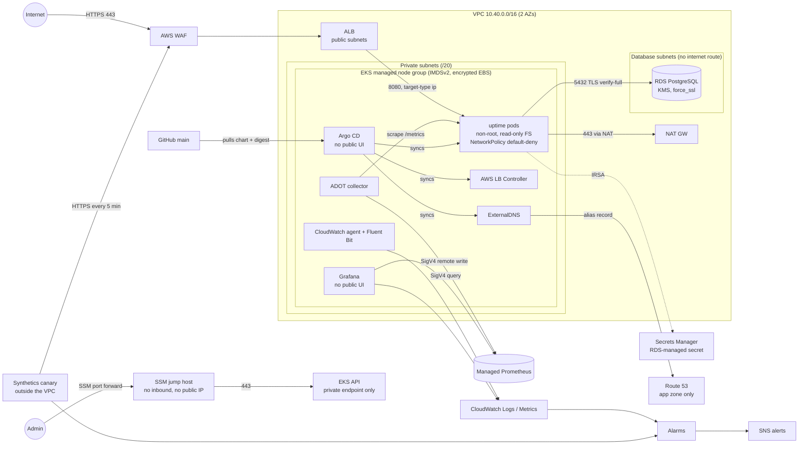

# Secure EKS + RDS Reference Stack

Terraform that provisions a VPC, an EKS cluster and a PostgreSQL RDS instance, and runs an
**uptime monitor** on them: a shared status board where anyone can add a public site, and the
cluster checks it every 1 to 60 minutes. Built **secure by default** and instrumented for
operations.

| | |
|---|---|
| **IaC** | Terraform ≥ 1.10, AWS provider 5.x, `terraform-aws-modules` (vpc, eks, iam) |
| **Compute** | EKS 1.34, one managed node group (`t3.medium`, AL2023 x86_64) |
| **Data** | RDS PostgreSQL 17, `db.t3.micro`, private, TLS-only |
| **Edge** | ALB via AWS Load Balancer Controller, ACM TLS, AWS WAF |
| **Observability** | Signals stored **outside** the cluster: Amazon Managed Prometheus (ADOT collector), CloudWatch logs, metrics and alarms → SNS, an external Synthetics canary; in-cluster Grafana to explore them |
| **Access** | Only the app is public. EKS API, Argo CD and Grafana are private: SSM tunnel + your IAM identity |
| **App** | Python status board + background checker; SSRF-safe checks (public addresses only, pinned IP, validated redirects) |
| **Going further** | Observability (primary), defense in depth, CI security scanning, modular Terraform |

---

## Architecture



**Request path:** client → WAF → ALB (TLS terminates here) → pod IP on 8080 → app reads its DB
credentials from Secrets Manager (IRSA) → PostgreSQL over TLS with full certificate verification.

**What is exposed:** the app's ALB, behind WAF, and nothing else. The EKS API has no public
endpoint; Argo CD and Grafana have no Ingress. Operators reach all three with `make tunnel` (an
SSM port forward through a jump host that has no inbound rules and no public IP) and authenticate
as themselves (IAM → EKS access entry → RBAC).

---

## Repository layout

```
bootstrap/                 One-time: state bucket (+ KMS), DNS zone, GitHub OIDC roles, workload boundary
terraform/
  main.tf                  Wires the modules together
  modules/
    log-storage/           KMS key + pre-created log groups (retention + encryption)
    network/               VPC, 3 subnet tiers, single NAT, flow logs, locked default SG
    eks-cluster/           EKS (private API), node group, pinned add-ons, IRSA roles
    jump-host/             SSM-only jump host for the private EKS API
    database/              RDS, parameter group (force_ssl), SG, KMS, enhanced monitoring
    app-platform/          ECR, app and ExternalDNS IRSA roles, WAF, ACM certificate
    managed-prometheus/    Amazon Managed Prometheus, ADOT collector and Grafana roles
    observability/         SNS, log metric filters, alarms, dashboard, Synthetics canary
addons/                    Argo CD and its Applications (LB controller, ExternalDNS, ADOT, Grafana, app),
                           admin passwords in Secrets Manager; runs through make tunnel
addons/dashboards/         Grafana dashboards as JSON
deploy/charts/uptime/      The app's Helm chart; values.yaml pins the image digest
app/                       Python status board, SSRF-safe checker, static UI, unit tests
scripts/                   release.sh, image.sh, tunnel.sh, destroy.sh, check-ci-permissions.sh, ci/
docs/runbook.md            What each alarm means and what to do about it
docs/reviewers.md          For reviewers: requirements → evidence, what to check, trade-offs
docs/standup.md            Every command, from an empty account to a verified stack and back
.github/workflows/         ci (lint, scan, test), terraform-plan (PRs), terraform-apply (main, approval-gated)
```

---

## Running it

The short version is below; [`docs/standup.md`](docs/standup.md) has every command, timings
and troubleshooting. Reviewers: start at [`docs/reviewers.md`](docs/reviewers.md).

### Prerequisites

Terraform ≥ 1.10, AWS CLI v2, kubectl, Docker with buildx, `jq`, and AWS credentials for the
target account.

### 1. Configure

```bash
cp terraform/terraform.tfvars.example terraform/terraform.tfvars
# set admin_cidrs to your IP (used only for break-glass):  curl -s https://checkip.amazonaws.com
# optional: domain_name + route53_zone_id for HTTPS, alert_email for notifications
```

### 2. Create the remote state backend (once)

```bash
make bootstrap        # creates the bucket + key, writes terraform/backend.hcl
```

### 3. Build everything

```bash
make up               # init → plan → apply (VPC, EKS, RDS, jump host, ...)
make tunnel           # in another terminal, and leave it running: the EKS API is private
make addons           # Argo CD + its apps, through the tunnel
make release          # build, scan and push the image; pins its digest in the chart
git commit -am "..." && open a PR, merge it   # Argo CD deploys it from main
```

`make up` takes roughly 20 minutes (EKS control plane ≈ 10, RDS ≈ 5). After that the main stack
changes through pull requests (see GitOps / CI) and the app through Argo CD. With a domain set,
ExternalDNS points it at the ALB within a minute or two of the Ingress getting one.

```bash
open https://<domain>/          # the status board: add a site, watch its signal strip fill in
make status                     # Argo CD apps, pods, ingress, network policies, dashboard link
make argocd                     # Argo CD UI on https://localhost:8080 (port-forward only)
make argocd-password            # its admin password, read from Secrets Manager
make grafana                    # Grafana on http://localhost:3000 (port-forward only)
make grafana-password           # its admin password, read from Secrets Manager
make incident MODE=down         # incident drill: break the demo service (MODE=ok to recover)
```

### 4. Tear down when not in use

```bash
make down
```

`destroy.sh` deletes the app's Argo CD Application first and waits for the controller to remove
the ALB.
Destroying the cluster first would orphan the ALB and its security groups and block VPC deletion.

**Approximate cost while running (us-east-1):** about $6–8/day. EKS control plane $0.10/h,
2× t3.medium, NAT gateway, ALB, db.t3.micro, WAF, KMS keys, Container Insights metrics.

---

## Security baseline: how each requirement is met

| Requirement | Implementation | Where |
|---|---|---|
| **IAM: least privilege** | App role can call `GetSecretValue` on **one** secret ARN, and `kms:Decrypt` only `kms:ViaService = secretsmanager`. VPC CNI, LB Controller and CloudWatch agent each have their own scoped role. CNI policy removed from the node role. | `app-platform`, `eks-cluster` |
| **IAM: IRSA, no static credentials** | All workloads use IRSA, each role scoped and capped by a permissions boundary: the app (one secret), ExternalDNS (one zone), the ADOT collector (write to one Prometheus workspace), Grafana (read-only). CI uses GitHub OIDC, no stored keys. Nodes use SSM, not SSH keys. EKS access entries, no `aws-auth` ConfigMap. | `app-platform`, `eks-cluster`, `managed-prometheus`, `bootstrap/` |
| **Network: private nodes and RDS** | Nodes in private subnets, RDS in database subnets with **no** internet or NAT route, `publicly_accessible = false`, no public IPs on launch. | `network`, `database` |
| **Network: SGs allow only required traffic** | RDS SG: only 5432 from the node SG, no egress rules. Default VPC SG stripped of all rules. ALB → pod rules managed by the controller. | `database`, `network` |
| **Network: private EKS API** | Private endpoint only. Admins use `make tunnel`: an SSM port-forward through a jump host with no inbound rules, no public IP and no Kubernetes access of its own, so `kubectl` still authenticates as the admin's IAM identity. Break-glass `eks_public_access` reopens the public endpoint to `admin_cidrs` only (validated, `0.0.0.0/0` rejected). | `jump-host`, `eks-cluster`, `variables.tf` |
| **Encryption at rest: RDS** | `storage_encrypted` with a customer-managed, rotating KMS key. | `database` |
| **Encryption at rest: EBS** | Node volumes `encrypted = true`, plus account-level `aws_ebs_encryption_by_default`. | `eks-cluster`, `main.tf` |
| **Encryption at rest: Kubernetes Secrets** | EKS envelope encryption with a dedicated, rotating KMS key. | `eks-cluster` |
| **Encryption at rest: logs, alerts, images** | All log groups and the SNS topic use a CMK; ECR uses KMS. | `log-storage`, `app-platform` |
| **Encryption in transit** | ALB: TLS 1.3/1.2 policy, HTTP → HTTPS redirect. RDS: `rds.force_ssl = 1`, app uses `sslmode=verify-full` against the RDS CA bundle. AWS APIs (including Prometheus remote write) over TLS with SigV4. | `deploy/charts/uptime/templates/ingress.yaml`, `database`, `app.py` |
| **Encrypted remote state with locking** | S3 + SSE-KMS (CMK), versioning, public access block, TLS-only bucket policy, S3 native lockfile (`use_lockfile = true`). | `bootstrap/` |
| **Secrets in Secrets Manager** | RDS generates and rotates the master password (`manage_master_user_password`). It **never** appears in code, manifests, images, git, or Terraform state. The app fetches it at runtime and re-fetches once on auth failure (rotation). The Argo CD and Grafana admin passwords are generated by Terraform and kept in Secrets Manager (own KMS key, decrypt only via Secrets Manager); Argo CD gets only a bcrypt hash. | `database`, `app.py`, `addons/` |
| **Workloads: non-root, unprivileged** | UID 10001, `runAsNonRoot`, `allowPrivilegeEscalation: false`, all capabilities dropped, read-only root FS, seccomp `RuntimeDefault`. The app and `observability` namespaces **enforce** Pod Security `restricted`, so a non-compliant pod is rejected (this caught an add-on that started injecting an unsafe init container). | `deploy/charts/uptime/`, `Dockerfile`, `addons/` |
| **Workloads: resource-limited** | CPU/memory requests and limits on every workload, PDB, bounded `emptyDir`; replicas spread one per node. | `deploy/charts/uptime/templates/deployment.yaml`, `addons/` |
| **Workloads: pinned images** | App deployed by **immutable digest** (`repo@sha256:…`); the chart refuses anything else. ECR tags immutable. Base image pinned by tag and digest. Helm charts, EKS add-ons and the ADOT image pinned to exact versions. | `deploy/charts/uptime/`, `addons/`, `eks-cluster` |

---

## Going further

### Observability (primary focus)

The rule: **whatever pages you must not share the fate of what it watches.** Metrics, logs and
alarms live in AWS services, not in the cluster; an external canary watches the public path.

| Signal | Lives in | Survives a cluster outage? |
|---|---|---|
| App metrics (requests, latency, checks, `db_up`) | **Amazon Managed Prometheus**, written by the ADOT collector (SigV4, IRSA) | Yes |
| Logs: app JSON, EKS control plane incl. **audit**, VPC flow, RDS, WAF | **CloudWatch Logs**, KMS-encrypted | Yes |
| ALB access logs (status, target, timings, TLS version per request) | **S3**, SSE-S3 (the only encryption ALB delivery supports), TLS-only policy, expire with the log retention | Yes |
| Node and pod metrics | CloudWatch **Container Insights** | Yes |
| Alarms → email | CloudWatch alarms → encrypted SNS topic | Yes |
| Public URL, checked like a visitor (internet → WAF → ALB → app) | **Synthetics canary**, outside the VPC, every 5 minutes | Yes |
| Dashboards | Grafana (in cluster, port-forward only) over the above | The view goes down, the data does not |

- **Health checks.** Startup, liveness (`/healthz`, no dependencies, so a DB outage does not
  restart pods) and readiness (`/readyz`, checks the DB). ALB health checks plus pod readiness
  gates make rollouts zero-downtime; measured: two consecutive rollouts, 385 probe requests,
  0 failures.
- **Alerts, by urgency.** Pages are symptoms users feel: `external-down` (the canary),
  `monitor-down` (our own services fail their uptime check), `5xx`, `no-running-pods`. Causes
  (DB errors, restarts, node/RDS CPU, memory, storage, connections) back them up. Every alarm has
  a [`runbook`](docs/runbook.md) entry. The [walkthrough](docs/walkthrough.md) is the interview narrative.
- **Dead man's switch.** Log-based alarms read silence as health. Each app pod logs a heartbeat
  a minute, and `telemetry-silent` fires (missing data = breaching) when they stop arriving.
  The canary's alarm notifies on `INSUFFICIENT_DATA`, so a canary that stops running is noticed.
- **SLOs.** The board shows each site's 7-day uptime against a 99.9% target, the error budget
  left, and p95 latency.
- **Incident drill.** `make incident MODE=down|slow|ok` breaks a demo service the board watches;
  the switch only listens inside the pod (reached by `kubectl exec`: IAM + RBAC). Rehearsed:
  board red in 43 s, `monitor-down` email in 2 m 39 s, recovery email after `MODE=ok`.
- **Dashboards.** Grafana's "Uptime board" (JSON in git, provisioned read-only) over Managed
  Prometheus and CloudWatch, plus one CloudWatch dashboard.

### Defense in depth

- **NetworkPolicy** (enforced natively by the VPC CNI): default deny in and out; the app may only
  receive 8080 from the VPC, and only send DNS to CoreDNS, 5432 to the database subnets, and 443
  to AWS APIs. IMDS is explicitly excluded.
- **WAF:** AWS Common and Known-Bad-Inputs rule groups, a per-IP rate limit, and a tighter one on
  adding sites (10 per IP per 10 minutes, answered with 429) so one visitor cannot fill the board.
  Logging with Authorization and Cookie headers redacted.
- **IMDSv2 with hop limit 1:** pods cannot reach node credentials.
- **Image scanning:** ECR scan-on-push, and `release.sh` refuses to pin an image with CRITICAL
  findings. Trivy in CI.
- **Audit logging:** EKS audit log and VPC flow logs.
- **Pinned EKS add-ons.** An add-on update that floated to "latest" once changed a default and
  injected an unsafe init container into every new pod; Pod Security rejected them, so nothing ran
  unsafely. Add-ons are now pinned, and upgrades are reviewed PRs with a plan.
- **SSRF-safe checker.** Users submit URLs, so every check is public-address-only, pinned to the
  validated IP, redirect-revalidated, GET/HEAD only. NetworkPolicy and WAF's SSRF rule are the
  second and third layers. `scripts/ssrf-probe.sh https://<domain>` sends 25 disguised internal
  addresses to the live board and shows which layer refused each one.

### GitOps / CI

On every PR: `terraform fmt`/`validate`, tflint, checkov (Terraform, the rendered chart, Dockerfile,
workflows), kubeconform, gitleaks, unit tests, hadolint, Trivy image scan. Every checkov skip is
listed with its reason in `.checkov.yaml`.

**Infrastructure:** GitHub Actions assumes AWS roles through OIDC (no stored keys). A PR that
touches `terraform/` gets a plan summary comment from a read-only role. Merging to `main` plans
again, waits for approval in the `production` environment, and applies only if the change list
matches the one that was reviewed. The public logs show resource addresses, never values.

**Cluster:** Argo CD keeps the load balancer controller, ExternalDNS and the app in sync with
`main`, reverting drift and pruning what is no longer declared. A release is a PR that changes the
image digest in `deploy/charts/uptime/values.yaml`. Values that name the account or environment
(role ARNs, database host, domain) are not in git: `addons/` reads them from the main stack's
outputs and gives them to Argo CD, because this repository is public. Argo CD's UI has no
Ingress; reach it with `make tunnel` + `make argocd`.

**CI permissions are tested.** `scripts/check-ci-permissions.sh` runs the IAM policy simulator
against the live CI roles (42 cases, allows and denies, e.g. "cannot touch the state bucket",
"cannot launch any instance type but the jump host's"). New permissions are simulated against the
*proposed* policy before they are applied.

### Reusability

Eight small modules with explicit inputs/outputs. Everything environment-specific is a variable
(region, sizes, AZ count, HA toggles, domain), and ARNs use `aws_partition`, so the same code
works in **GovCloud** (`aws-us-gov`).

---

## Security exceptions (deliberate, for cost or scope)

| Exception | Why | Production answer |
|---|---|---|
| Jump host egress to SSM over the NAT | Avoids three SSM interface endpoints (~$22/month per AZ) | `ssm`, `ssmmessages` and `ec2messages` VPC endpoints, and drop the jump host's internet egress |
| x86 (`t3.medium`, `db.t3.micro`) instead of Graviton | The provided account's SCP (`DenyExpensiveEC2InstanceTypes`) denies all Graviton types and anything above `t3.medium` | `t4g.medium` + `node_ami_type = "AL2023_ARM_64_STANDARD"` + `IMAGE_PLATFORM=linux/arm64`, `db.t4g.micro`: ~20% cheaper, no code change beyond variables |
| Single NAT gateway | About $33/month per extra NAT | `single_nat_gateway = false` (one per AZ) |
| RDS single-AZ, no deletion protection, no final snapshot | Cost and one-command teardown | `db_multi_az = true`, `db_deletion_protection = true` |
| App connects as the RDS master user | Keeps the exercise to one secret | Migration job creates a least-privilege app role; app gets a separate rotated secret, or IAM DB auth |
| Node SG shared by all pods | Pods inherit the node SG, so any pod could reach RDS at the SG layer (NetworkPolicy still restricts it) | Security Groups for Pods, so only app pods carry the RDS-allowed SG |
| Egress 443 to the internet (via NAT) for AWS APIs | Avoids ~$7/month per AZ per interface endpoint | VPC interface endpoints (STS, Secrets Manager, ECR, Logs) and drop the 0.0.0.0/0 rule |
| HTTP only if no domain is configured | ACM requires a domain | Always set `domain_name` |
| App subdomain zone without DNSSEC | The parent domain (hosted elsewhere) is unsigned, so a signed child would not be validated | Sign parent and child; publish the child's DS record at the parent |
| No Route 53 query logging | Demo scope | Query logs to an encrypted CloudWatch log group |
| CI plan role uses AWS `ReadOnlyAccess` | `terraform plan` must read every resource type in the stack; the role cannot write and cannot read secret values | A custom read policy generated from CloudTrail (IAM Access Analyzer policy generation) |
| CI apply role's EC2 and KMS permissions are region-wide, not per resource | EC2 networking has little resource-level scoping, and KMS tag conditions can take 5 minutes to apply to a new key; the state key is explicitly denied | A dedicated account per stack, so "region-wide" means "this stack" |
| 14-day log retention | Demo | ≥ 1 year, or export to S3/Glacier |
| LB Controller and CloudWatch agent run in `kube-system`/`amazon-cloudwatch` with broader privileges | Platform components need node/AWS access | Run via EKS managed add-ons where available; restrict with admission policy (Kyverno/Gatekeeper) |
| Registry modules pinned by version, not commit hash | Readability | Pin by hash or vendor the modules; Dependabot/Renovate for updates |
| Argo CD and Grafana admin passwords are also in the `addons/` Terraform state | Terraform generates them; the state is in the private bucket, SSE-KMS, TLS-only | Generate them outside Terraform (Secrets Manager `GetRandomPassword` + External Secrets), or replace local admin with SSO |
| Admin UIs private, no SSO | Managed Grafana and Argo CD SSO would need an identity provider; the IAM Identity Center visible here is the organization's corporate directory, out of scope for this account | Amazon Cognito user pool with mandatory TOTP MFA, OIDC login in Argo CD and Grafana, read-only roles for viewers, ALB `authenticate-cognito` + WAF IP allowlist |
| ADOT, Grafana and controller images pinned by version tag, not digest | Upstream charts set tags | Pin by digest in values; admission policy to require digests |
| Managed Prometheus and the canary bucket use AWS-owned / S3-managed keys | Metrics and canary results hold counts, timings and status codes, no customer data | Customer-managed KMS keys |
| ALB access-log bucket uses S3-managed keys | ALB log delivery supports SSE-S3 only | Accept, or forward logs to an SSE-KMS bucket or log store |
| Base image carries HIGH CVEs with no fix available (Debian `sqlite3`, `util-linux`, `glibc`, `zlib`, as reported by Inspector) | No patched package exists yet; `release.sh` refuses CRITICALs. The app never uses `sqlite3` and never decompresses response bodies (`zlib`); `glibc` does resolve user-submitted host names, so its CVEs are the ones to watch | Distroless or Chainguard Python base, rebuilt automatically when fixes land |
| In-cluster Grafana | No SSO available (above); data stays outside the cluster | Amazon Managed Grafana once an identity provider is available |

---

## Threat model: what a compromise could reach

**Exposed to the internet:** the app's ALB (behind WAF) and nothing else. On it, the board, its API
and the health checks; `/metrics` and `/internal/` answer 404 (WAF, then the app), so metrics are
only readable from inside the cluster.

### The app pod (the only internet-facing workload)

- **AWS:** read the one database secret. Nothing else. No node credentials (IMDS hop limit 1 and
  NetworkPolicy block 169.254.169.254), no Kubernetes API token (`automountServiceAccountToken: false`).
- **Network:** PostgreSQL in the database subnets, HTTP(S) outbound to public addresses (the
  checker's job). No other pods, namespaces or internal services (default-deny NetworkPolicy).
- **Host:** non-root, no capabilities, read-only filesystem, seccomp, PSA `restricted`.
  Escaping needs a kernel/runtime vulnerability.
- **Data:** full access to the demo database, because the app uses the master user (see exceptions).
- **Detection:** WAF and ALB access logs, EKS audit log, VPC flow logs, DB-error and 5xx alarms.

### Everything else

| If an attacker gets… | They could reach | They could not | What limits it |
|---|---|---|---|
| A user's tricked URL on the board (SSRF attempt) | Public websites only | IMDS, the VPC, the cluster | Checker refuses non-public addresses (pinned IP, revalidated redirects); NetworkPolicy; WAF SSRF rule |
| The ADOT collector pod | Write metrics to one Prometheus workspace; list pods | Read secrets, read metrics, change anything | IRSA policy + boundary; read-only ClusterRole; PSA `restricted` |
| The Grafana pod | Read metrics, CloudWatch logs and alarms, X-Ray | Write anywhere | Read-only IRSA role; no Ingress |
| Argo CD | Deploy anything into the cluster | Change AWS resources (it has no AWS role) | No public UI; only reachable through the private API; admin password in Secrets Manager |
| An operator's laptop session | What that IAM identity's EKS access entry allows | — | MFA on the IAM identity, short-lived credentials, CloudTrail + EKS audit log |
| The GitHub CI apply role | Change the main stack's scoped resources, **after a human approves** in the `production` environment | Touch state, the CI roles, the boundary, or roles without the boundary | OIDC trust pinned to this repository's immutable IDs; scoped policies; permissions boundary; tested with the IAM simulator |
| The jump host | Open TCP to the EKS API (still needs Kubernetes credentials) | Anything in AWS beyond SSM | SSM-only role, no inbound rules, no public IP, no Kubernetes access of its own |

**Next hardening steps:** least-privilege DB role, Security Groups for Pods, VPC endpoints with
egress lockdown, GuardDuty EKS Runtime Monitoring, admission policy (signed images only, cosign),
SSO with MFA for the admin UIs.

---

## TODO / known gaps

- [x] Automated `plan` on PR and approval-gated `apply` on merge via GitHub OIDC
- [x] External synthetic canary on the public URL
- [x] Managed Prometheus + Grafana scraping the app's `/metrics`
- [ ] Traces: OpenTelemetry in the app → ADOT (OTLP receiver already in place) → X-Ray
- [ ] Nightly drift detection (`terraform plan` from CI, filing a GitHub issue rather than paging)
- [ ] Burn-rate alerts on the SLOs instead of fixed thresholds
- [ ] HPA (needs metrics-server) and Cluster Autoscaler/Karpenter
- [ ] Least-privilege PostgreSQL role for the app; schema migrations as a Job
- [ ] Pin GitHub Actions and all images by digest; Renovate for updates
- [ ] Network-policy agent drop logging (`enable-policy-event-logs`) for faster debugging
