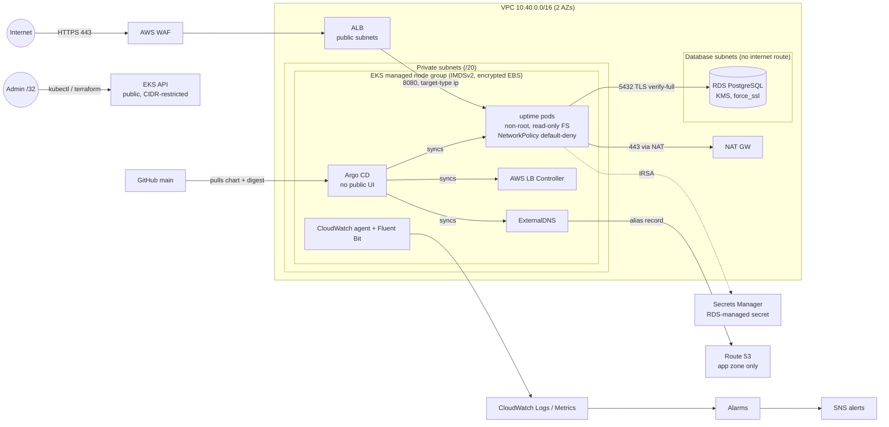

# Secure EKS + RDS Reference Stack

Terraform that provisions a VPC, an EKS cluster, a PostgreSQL RDS instance and a small
demo API that uses it, built **secure by default** and instrumented for operations.

| | |
|---|---|
| **IaC** | Terraform ≥ 1.10, AWS provider 5.x, `terraform-aws-modules` (vpc, eks, iam) |
| **Compute** | EKS 1.34, one managed node group (`t3.medium`, AL2023 x86_64) |
| **Data** | RDS PostgreSQL 17, `db.t3.micro`, private, TLS-only |
| **Edge** | ALB via AWS Load Balancer Controller, ACM TLS, AWS WAF |
| **Observability** | Container Insights, Fluent Bit → CloudWatch Logs, log-derived app metrics, alarms → SNS, dashboard |
| **Going further** | Observability (primary), defense in depth, CI security scanning, modular Terraform |

---

## Architecture



**Request path:** client → WAF → ALB (TLS terminates here) → pod IP on 8080 → app reads its DB
credentials from Secrets Manager (IRSA) → PostgreSQL over TLS with full certificate verification.

---

## Repository layout

```
bootstrap/                 One-time: state bucket (+ KMS), DNS zone, GitHub OIDC roles, workload boundary
terraform/
  main.tf                  Wires the modules together
  modules/
    log-storage/           KMS key + pre-created log groups (retention + encryption)
    network/               VPC, 3 subnet tiers, single NAT, flow logs, locked default SG
    eks-cluster/           EKS, node group, managed add-ons, IRSA roles
    database/              RDS, parameter group (force_ssl), SG, KMS, enhanced monitoring
    app-platform/          ECR, app and ExternalDNS IRSA roles, WAF, ACM certificate
    observability/         SNS, log metric filters, alarms, dashboard
addons/                    Argo CD, and the Applications it keeps in sync (needs EKS API access)
deploy/charts/uptime/      The app's Helm chart; values.yaml pins the image digest
app/                       Python API, Dockerfile, unit tests
scripts/                   release.sh, destroy.sh, ci/ (plan/apply helpers)
docs/runbook.md            What each alarm means and what to do about it
.github/workflows/         ci (lint, scan, test), terraform-plan (PRs), terraform-apply (main, approval-gated)
```

---

## Running it

### Prerequisites

Terraform ≥ 1.10, AWS CLI v2, kubectl, Docker with buildx, `jq`, and AWS credentials for the
target account.

### 1. Configure

```bash
cp terraform/terraform.tfvars.example terraform/terraform.tfvars
# set admin_cidrs to your IP:  curl -s https://checkip.amazonaws.com
# optional: domain_name + route53_zone_id for HTTPS, alert_email for notifications
```

### 2. Create the remote state backend (once)

```bash
make bootstrap        # creates the bucket + key, writes terraform/backend.hcl
```

### 3. Build everything

```bash
make up               # init → plan → apply → addons (Argo CD + its apps)
make release          # build, scan and push the image; pins its digest in the chart
git commit -am "..." && open a PR, merge it   # Argo CD deploys it from main
```

`make up` takes roughly 20 minutes (EKS control plane ≈ 10, RDS ≈ 5). After that the main stack
changes through pull requests (see GitOps / CI) and the app through Argo CD. With a domain set,
ExternalDNS points it at the ALB within a minute or two of the Ingress getting one.

```bash
curl https://<domain>/          # {"message": "...", "pod": "uptime-...", "visits": 3}
make status                     # Argo CD apps, pods, ingress, network policies, dashboard link
make argocd                     # Argo CD UI on https://localhost:8443 (port-forward only)
```

### 4. Tear down when not in use

```bash
make down
```

`destroy.sh` deletes the app's Argo CD Application first and waits for the controller to remove
the ALB.
Destroying the cluster first would orphan the ALB and its security groups and block VPC deletion.

**Approximate cost while running (us-east-1):** about $6–8/day. EKS control plane $0.10/h,
2× t3.medium, NAT gateway, ALB, db.t3.micro, WAF, KMS keys, Container Insights metrics.

---

## Security baseline: how each requirement is met

| Requirement | Implementation | Where |
|---|---|---|
| **IAM: least privilege** | App role can call `GetSecretValue` on **one** secret ARN, and `kms:Decrypt` only `kms:ViaService = secretsmanager`. VPC CNI, LB Controller and CloudWatch agent each have their own scoped role. CNI policy removed from the node role. | `app-platform`, `eks-cluster` |
| **IAM: IRSA, no static credentials** | All workloads use IRSA. No access keys anywhere; nodes use SSM, not SSH keys. EKS access entries (`authentication_mode = "API"`), no `aws-auth` ConfigMap. | `eks-cluster`, `k8s/10-serviceaccount.yaml` |
| **Network: private nodes and RDS** | Nodes in private subnets, RDS in database subnets with **no** internet or NAT route, `publicly_accessible = false`, no public IPs on launch. | `network`, `database` |
| **Network: SGs allow only required traffic** | RDS SG: only 5432 from the node SG, no egress rules. Default VPC SG stripped of all rules. ALB → pod rules managed by the controller. | `database`, `network` |
| **Network: restricted EKS API** | Private endpoint on; public endpoint limited to `admin_cidrs` (validated, `0.0.0.0/0` rejected). | `eks-cluster`, `variables.tf` |
| **Encryption at rest: RDS** | `storage_encrypted` with a customer-managed, rotating KMS key. | `database` |
| **Encryption at rest: EBS** | Node volumes `encrypted = true`, plus account-level `aws_ebs_encryption_by_default`. | `eks-cluster`, `main.tf` |
| **Encryption at rest: Kubernetes Secrets** | EKS envelope encryption with a dedicated, rotating KMS key. | `eks-cluster` |
| **Encryption at rest: logs, alerts, images** | All log groups and the SNS topic use a CMK; ECR uses KMS. | `log-storage`, `app-platform` |
| **Encryption in transit** | ALB: TLS 1.3/1.2 policy, HTTP → HTTPS redirect. RDS: `rds.force_ssl = 1`, app uses `sslmode=verify-full` against the RDS CA bundle. AWS APIs over TLS. | `k8s/60-ingress.yaml`, `database`, `app.py` |
| **Encrypted remote state with locking** | S3 + SSE-KMS (CMK), versioning, public access block, TLS-only bucket policy, S3 native lockfile (`use_lockfile = true`). | `bootstrap/` |
| **Secrets in Secrets Manager** | RDS generates and rotates the master password (`manage_master_user_password`). It **never** appears in code, manifests, images, git, or Terraform state. The app fetches it at runtime and re-fetches once on auth failure (rotation). | `database`, `app.py` |
| **Workloads: non-root, unprivileged** | UID 10001, `runAsNonRoot`, `allowPrivilegeEscalation: false`, all capabilities dropped, read-only root FS, seccomp `RuntimeDefault`. Namespace **enforces** Pod Security `restricted`, so a non-compliant pod is rejected. | `k8s/`, `Dockerfile` |
| **Workloads: resource-limited** | CPU/memory requests and limits, PDB, bounded `emptyDir`. | `k8s/30-deployment.yaml` |
| **Workloads: pinned images** | App deployed by **immutable digest** (`repo@sha256:…`); render script refuses anything else. ECR tags immutable. Base image pinned to an exact patch tag. Helm chart and add-ons pinned. | `scripts/`, `app-platform` |

---

## Going further

### Observability (primary focus)

- **Health checks.** Startup, liveness (`/healthz`, no dependencies, so a DB outage does not
  restart pods) and readiness (`/readyz`, checks the DB, so unhealthy pods leave the Service).
  ALB health checks plus pod readiness gates make rollouts zero-downtime.
- **Metrics.** Container Insights (node/pod CPU, memory, restarts, running pods), RDS metrics
  plus Enhanced Monitoring, and Prometheus `/metrics` on the app (request counts, latency
  histogram, `db_up`).
- **Logs.** The app emits one JSON object per request. Fluent Bit ships it to CloudWatch, and
  metric filters turn those lines into `RequestCount`, `Http5xxCount` and `DbErrorCount` without
  giving the app CloudWatch permissions. EKS control plane logs (including **audit**), VPC flow
  logs, RDS logs and WAF logs are all retained and KMS-encrypted.
- **Alerting.** Symptom-based alarms first (5xx, no running pods), then cause-based (restarts,
  DB errors, node CPU, RDS CPU/storage/connections/memory), all to an encrypted SNS topic.
  [`docs/runbook.md`](docs/runbook.md) covers what each alarm means and the first steps.
- **Dashboard.** One CloudWatch dashboard: alarm status, requests vs errors, pods, nodes, RDS, WAF.

### Defense in depth

- **NetworkPolicy** (enforced natively by the VPC CNI): default deny in and out; the app may only
  receive 8080 from the VPC, and only send DNS to CoreDNS, 5432 to the database subnets, and 443
  to AWS APIs. IMDS is explicitly excluded.
- **WAF:** AWS Common and Known-Bad-Inputs rule groups plus a per-IP rate limit, with logging
  (Authorization and Cookie headers redacted).
- **IMDSv2 with hop limit 1:** pods cannot reach node credentials.
- **Image scanning:** ECR scan-on-push, and `release.sh` refuses to pin an image with CRITICAL
  findings. Trivy in CI.
- **Audit logging:** EKS audit log and VPC flow logs.

### GitOps / CI

On every PR: `terraform fmt`/`validate`, tflint, checkov (Terraform, the rendered chart, Dockerfile,
workflows), kubeconform, gitleaks, unit tests, hadolint, Trivy image scan. Every checkov skip is
listed with its reason in `.checkov.yaml`.

**Infrastructure:** GitHub Actions assumes AWS roles through OIDC (no stored keys). A PR that
touches `terraform/` gets a plan summary comment from a read-only role. Merging to `main` plans
again, waits for approval in the `production` environment, and applies only if the change list
matches the one that was reviewed. The public logs show resource addresses, never values.

**Cluster:** Argo CD keeps the load balancer controller, ExternalDNS and the app in sync with
`main`, reverting drift and pruning what is no longer declared. A release is a PR that changes the
image digest in `deploy/charts/uptime/values.yaml`. Values that name the account or environment
(role ARNs, database host, domain) are not in git: `addons/` reads them from the main stack's
outputs and gives them to Argo CD, because this repository is public. Argo CD's UI has no
Ingress; reach it with `make argocd`.

### Reusability

Six small modules with explicit inputs/outputs. Everything environment-specific is a variable
(region, sizes, AZ count, HA toggles, domain), and ARNs use `aws_partition`, so the same code
works in **GovCloud** (`aws-us-gov`).

---

## Security exceptions (deliberate, for cost or scope)

| Exception | Why | Production answer |
|---|---|---|
| Public EKS endpoint (CIDR-restricted) | Lets Terraform and kubectl run from a workstation without a VPN or bastion | Private endpoint only; access via SSM bastion, VPN or a CI runner inside the VPC |
| x86 (`t3.medium`, `db.t3.micro`) instead of Graviton | The provided account's SCP (`DenyExpensiveEC2InstanceTypes`) denies all Graviton types and anything above `t3.medium` | `t4g.medium` + `node_ami_type = "AL2023_ARM_64_STANDARD"` + `IMAGE_PLATFORM=linux/arm64`, `db.t4g.micro`: ~20% cheaper, no code change beyond variables |
| Single NAT gateway | About $33/month per extra NAT | `single_nat_gateway = false` (one per AZ) |
| RDS single-AZ, no deletion protection, no final snapshot | Cost and one-command teardown | `db_multi_az = true`, `db_deletion_protection = true` |
| App connects as the RDS master user | Keeps the exercise to one secret | Migration job creates a least-privilege app role; app gets a separate rotated secret, or IAM DB auth |
| Node SG shared by all pods | Pods inherit the node SG, so any pod could reach RDS at the SG layer (NetworkPolicy still restricts it) | Security Groups for Pods, so only app pods carry the RDS-allowed SG |
| Egress 443 to the internet (via NAT) for AWS APIs | Avoids ~$7/month per AZ per interface endpoint | VPC interface endpoints (STS, Secrets Manager, ECR, Logs) and drop the 0.0.0.0/0 rule |
| HTTP only if no domain is configured | ACM requires a domain | Always set `domain_name` |
| App subdomain zone without DNSSEC | The parent domain (hosted elsewhere) is unsigned, so a signed child would not be validated | Sign parent and child; publish the child's DS record at the parent |
| No Route 53 query logging | Demo scope | Query logs to an encrypted CloudWatch log group |
| CI plan role uses AWS `ReadOnlyAccess` | `terraform plan` must read every resource type in the stack; the role cannot write and cannot read secret values | A custom read policy generated from CloudTrail (IAM Access Analyzer policy generation) |
| CI apply role's EC2 and KMS permissions are region-wide, not per resource | EC2 networking has little resource-level scoping, and KMS tag conditions can take 5 minutes to apply to a new key; the state key is explicitly denied | A dedicated account per stack, so "region-wide" means "this stack" |
| 14-day log retention | Demo | ≥ 1 year, or export to S3/Glacier |
| LB Controller and CloudWatch agent run in `kube-system`/`amazon-cloudwatch` with broader privileges | Platform components need node/AWS access | Run via EKS managed add-ons where available; restrict with admission policy (Kyverno/Gatekeeper) |
| Registry modules pinned by version, not commit hash | Readability | Pin by hash or vendor the modules; Dependabot/Renovate for updates |

---

## Threat model: if the app pod is compromised, what can the attacker reach?

- **AWS:** read the one database secret. Nothing else. No node credentials (IMDS hop limit 1 and
  NetworkPolicy block 169.254.169.254), no Kubernetes API token (`automountServiceAccountToken: false`).
- **Network:** PostgreSQL in the database subnets and HTTPS outbound. No other pods, namespaces or
  internal services (default-deny NetworkPolicy).
- **Host:** non-root, no capabilities, read-only filesystem, seccomp, PSA `restricted`.
  Escaping needs a kernel/runtime vulnerability.
- **Data:** full access to the demo database, because the app uses the master user (see exceptions).
- **Detection:** WAF logs, EKS audit log, VPC flow logs, DB error and 5xx alarms.

**Next hardening steps:** least-privilege DB role, Security Groups for Pods, VPC endpoints with
egress lockdown, GuardDuty EKS Runtime Monitoring, admission policy (signed images only, cosign).

---

## TODO / known gaps

- [ ] Automated `plan` on PR and `apply` on merge via GitHub OIDC (no long-lived AWS keys in CI)
- [ ] ALB-level alarms (target 5xx, p99 latency) and a synthetic canary; the ALB is created by the
      controller, so its ARN is not a Terraform output today
- [ ] HPA (needs metrics-server) and Cluster Autoscaler/Karpenter
- [ ] Least-privilege PostgreSQL role for the app; schema migrations as a Job
- [ ] Pin GitHub Actions and base images by digest; Renovate for updates
- [ ] Prometheus/Grafana (AMP/AMG) scraping the app's `/metrics` directly
- [ ] If Container Insights reports missing host metadata, the CloudWatch add-on may need IMDS hop
      limit 2 (`node_imds_hop_limit`); documented trade-off against node-credential exposure
